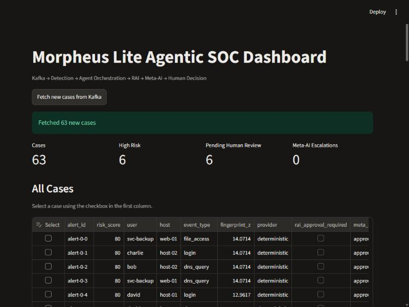
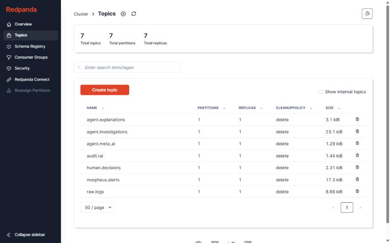
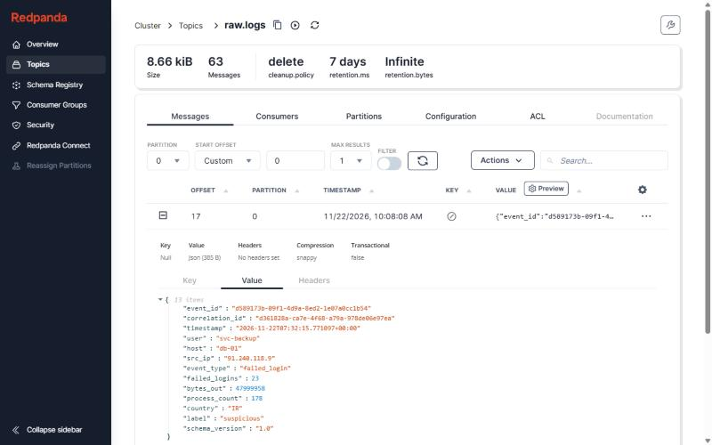
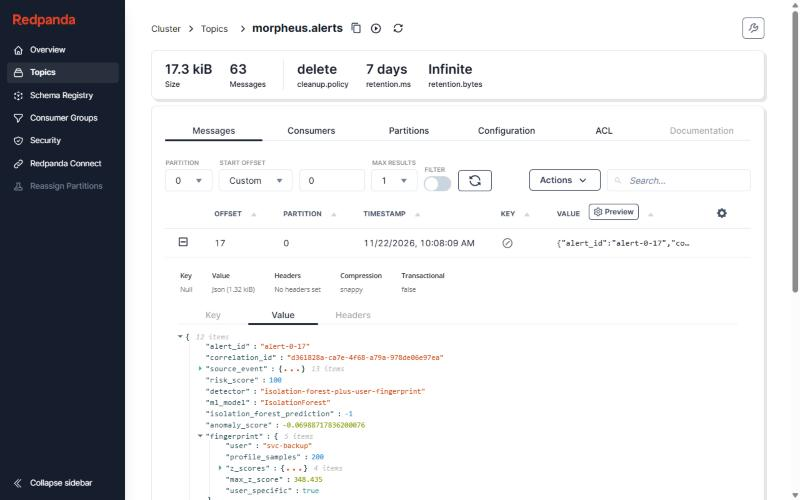
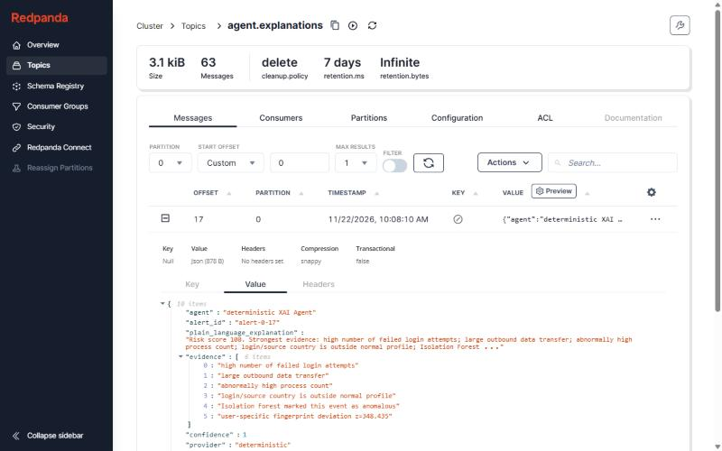
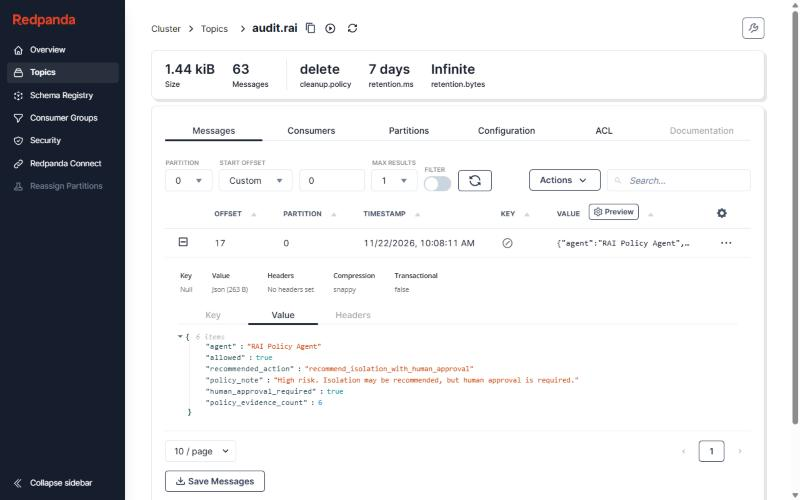
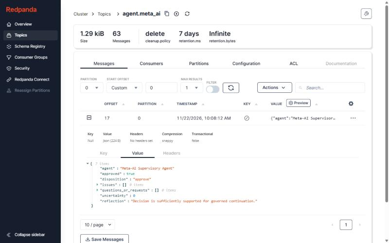
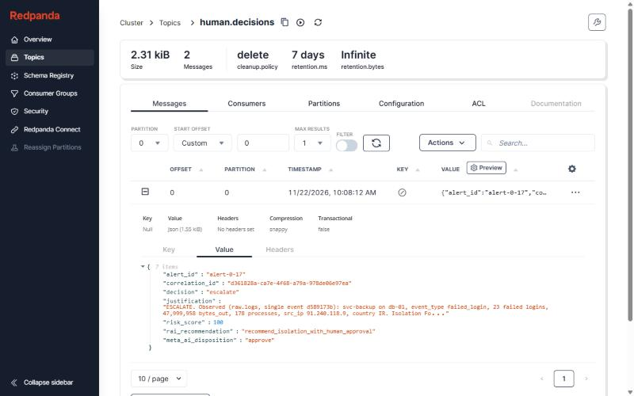
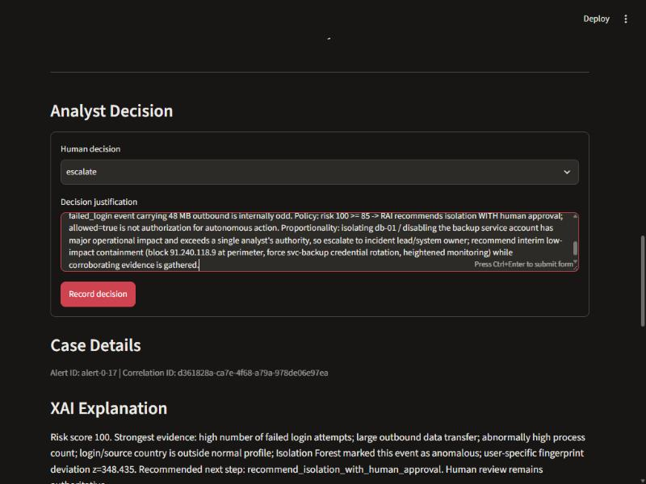
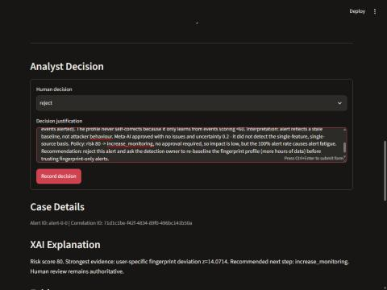

# Laboratory 2a - Student Worksheet

**Morpheus Lite | Human-AI Decision-Making in an AI-Augmented SOC**
Lecture 5: Explainable, Responsible, and Meta-AI in Cybersecurity

Run date: 22 Nov 2026 (07:31-07:35 UTC). Synthetic telemetry only. No real remediation was executed.

---

## 1. Prepare and verify the environment

Checkout: `akojukhov-bit/Lab2a-morpheus-lite`, branch main, commit `2a47bb8` (README says v1.0, pyproject says 0.2.0).

```powershell
python -m venv .venv
.venv\Scripts\Activate.ps1
python -m pip install --upgrade pip
python -m pip install -e ".[research,dev]"
python -m pytest -q
```

**pytest result:** `5 passed in 0.09s` (Windows 11, Python 3.12.10). No failures.

**Inference provider:** I set `$env:MORPHEUS_INFERENCE_PROVIDER="deterministic"` before starting the orchestrator. Ollama was not used.

## 2. Start the system

```powershell
docker compose up -d redpanda redpanda-console
docker compose ps
```

Both containers came up, and redpanda showed as healthy.

| Terminal | Command |
|---|---|
| 1 | `docker compose up -d redpanda redpanda-console` |
| 2 | `python telemetry_generator.py` |
| 3 | `python morpheus_lite_detector.py` |
| 4 | `$env:MORPHEUS_INFERENCE_PROVIDER="deterministic"; python agent_orchestrator.py` |
| 5 | `python -m streamlit run dashboard.py` |

I actually started terminals 3 and 4 before terminal 2 (the order from the Lecture 4 slides). The consumers read from `latest`, so if the generator starts first the early events are skipped. After about a minute I stopped the generator, so the case list wouldn't keep changing while I worked.

Console: http://localhost:8080. Dashboard: http://localhost:8501. "Fetch new cases from Kafka" returned **63 cases**.



## 3. Select and synchronize a case

No case was assigned, so I didn't just take the highest-risk one. I took two:
- **alert-0-17**: the first case marked REVIEW REQUIRED (main case)
- **alert-0-0**: a normal-looking case, to compare against

For both, the same alert_id appeared in All Cases, Active Alert, Human Decision Queue and Case Details.

| Case field | alert-0-17 | alert-0-0 |
|---|---|---|
| alert_id | alert-0-17 | alert-0-0 |
| correlation_id | d361828a-ca7e-4f68-a79a-978de06e97ea | 71d1c1be-f42f-4834-89f0-496bc141b50a |
| scenario / event type | failed_login | file_access |
| risk score / severity | 100 / high | 80 / medium |
| user / host | svc-backup / db-01 | svc-backup / web-01 |
| inference provider | deterministic | deterministic |
| RAI approval required | true | false |
| current human decision | pending -> escalate | pending -> reject |

## 4. Trace the case through Redpanda (alert-0-17)

| Topic | What I found |
|---|---|
| raw.logs | Offset 17: svc-backup, db-01, src_ip 91.240.118.9, country IR, failed_logins 23, bytes_out 47,999,958, process_count 178. Has the correlation_id but no alert_id. |
| morpheus.alerts | alert-0-17, risk 100, Isolation Forest -1, fingerprint z: bytes_out 348.4, failed_logins 21.7, login_hour 14.1. Six reasons. |
| agent.investigations | Findings: brute force / credential stuffing, possible exfiltration, fingerprint deviation. MITRE TA0006, TA0010, TA0004. Status awaiting_human_decision. |
| agent.explanations | Provider deterministic, confidence 1.0. The text just lists the six reasons and the RAI action. |
| audit.rai | allowed true, recommend_isolation_with_human_approval, human_approval_required true, policy_evidence_count 6 |
| agent.meta_ai | approved true, disposition approve, no issues, uncertainty 0.0 |
| human.decisions | decision escalate, full justification, risk 100 |

The full topic dumps are in [evidence/](evidence/).

**Redpanda Console screenshots (http://localhost:8080).** During the live run I traced the topics with `rpk` from the command line. To get Console screenshots afterwards, I started Redpanda again and loaded the exact recorded messages from `evidence/` back into the same 7 topics. The offsets and content are identical to the original run; only the Console's message timestamp shows the reload time (the original time is in each event's `timestamp` field).

All 7 topics:


raw.logs, offset 17 (the original event; no alert_id yet):


morpheus.alerts, alert-0-17 (risk 100, Isolation Forest -1, fingerprint z 348):


agent.explanations (XAI, provider deterministic):


audit.rai (isolation needs human approval):


agent.meta_ai (approve, no issues, uncertainty 0):


human.decisions, offset 0 (my escalate decision for alert-0-17):


**Q: Why is alert_id useful for selecting one dashboard case, while correlation_id may be useful for tracing related backend events?**
alert_id is only created when the detector raises an alert (it's partition + offset, so `alert-0-17`), and the dashboard keys cases on it. correlation_id is created together with the raw event, so it already exists in raw.logs before there is any alert. It then follows the event into the alert, the investigation and the decision. With correlation_id I can go back to the original telemetry. With alert_id I can't, because raw.logs doesn't have it.

**Evidence verification record**

| Source | Checked | Result |
|---|---|---|
| Original telemetry | Checked | Supported |
| Detector alert | Checked | Supported (but every reason comes from the same single record) |
| XAI claim | Checked | Supported (it only repeats the detector) |
| RAI rule | Checked against config/policies.yaml | Supported |
| Meta-AI concern | Checked | Uncertain (it raised nothing) |
| Independent corroboration | Unavailable | No MFA/IdP, NetFlow, firewall or EDR data in the lab |

## 5. Analyze evidence before deciding

### 5.1 Detection evidence

| Evidence item / source | Observed fact | Supports recommendation? | Independently checked? |
|---|---|---|---|
| Original telemetry | 23 failed logins, 48 MB out, 178 processes, external IP in IR, service account on a DB host | Yes | Yes |
| Detector alert | Isolation Forest anomalous, fingerprint z 348 (bytes_out) | Yes | Yes, recomputed from the features |
| Additional source | Not available | Uncertain | No |

- **Q1 Evidence completeness:** Adequate
- **Q2 Confidence before XAI:** High
- **Q3 Strongest / missing evidence:** The strongest evidence is the failed logins plus 48 MB leaving to an external IP from a database host. What's missing is any second, independent source. All six reasons come from one log line. It's also strange that a failed_login event carries 48 MB of outbound traffic.

### 5.2 XAI

**Provider:** deterministic

- **Q4 Understandable:** Agree
- **Q5 Connects evidence to recommendation:** Neutral. It lists the evidence and the action next to each other but doesn't explain the link.
- **Q6 Changed my understanding?** No. It repeats the detector reasons word for word.
- **Q7 Confidence after XAI:** High
- **Q8 Introduced new information?** No
- **Q9 Change in trust:** Decreased. "confidence 1.0" is just risk_score / 100, not a real probability.
- **Q10 Independently verified?** Yes

### 5.3 RAI

The fields were allowed=true, recommended_action=recommend_isolation_with_human_approval, human_approval_required=true and policy_evidence_count=6. The thresholds are 60/85.

- **Q11 Understandable:** Strongly agree
- **Q12 Clarified risks:** Agree
- **Q13 Useful beyond detector:** Agree
- **Q14 Influenced my thinking?** Yes. It made it clear that allowed=true does not mean the system may isolate on its own. A person has to approve.
- **Policy constraint:** Risk 100 is at least 85, so isolation can only be recommended and needs human approval. One weakness: policy_evidence_count only counts reasons. Six reasons from one record still pass the "at least 2 evidence" rule.

### 5.4 Meta-AI

The fields were approved=true, disposition=approve, issues=[], questions_or_requests=[] and uncertainty=0.0.

- **Q15 Improved understanding:** Disagree
- **Q16 Identified useful limitations:** Strongly disagree
- **Q17 Encouraged verification:** Disagree
- **Q18 Overall usefulness:** Slightly useful
- **Limitation:** Uncertainty is calculated as 1 - risk/100, so any risk-100 case automatically gets uncertainty 0. Meta-AI is grading the detector using the detector's own score.

**Something I noticed across all cases:** all 63 events became alerts, including 57 normal ones (risk 80). Their only reason was a fingerprint z of about 14, and it came entirely from `login_hour`. The fingerprint file shipped with the repo was learned almost only at 06:00 UTC (199 of 200 samples per user), and I ran at 07:00. The profile also never fixes itself, because it only learns from events that scored under 60. Meta-AI approved all 63 cases and flagged none of this.

## 6. Human decision

**alert-0-17: escalate**, confidence High

Justification (as entered in the dashboard): One log line shows svc-backup on db-01 with 23 failed logins, about 48 MB outbound and 178 processes, from 91.240.118.9 (IR). Isolation Forest flags it and the fingerprint z for bytes_out is 348. This looks like a credential attack followed by possible exfiltration, but nothing confirms it independently: no MFA or firewall data, and every reason comes from the same record. The XAI confidence 1.0 and Meta-AI uncertainty 0 aren't real measures. Policy says isolation needs human approval at risk 85 or above. Isolating a database server and the backup account has a big operational impact, more than one analyst should decide. I escalated to the incident lead / system owner and suggested low-impact steps in the meantime: block the IP, rotate the svc-backup password, and increase monitoring.

**alert-0-0: reject**, confidence High

Justification: A normal file_access from internal IP 10.0.0.30 (US), 1 failed login, 191 KB out. Isolation Forest says not anomalous. The only reason is the fingerprint z of 14, which comes entirely from login_hour, so it's the stale 06:00 baseline. I asked for the profile to be re-baselined.

Sources used: ☑ Detector ☑ XAI ☑ RAI ☑ Meta-AI ☐ Independent evidence ☑ Own domain knowledge

Decision sovereignty: ☑ Multiple information sources contributed to my decision. I did not follow Meta-AI's "approve".

What most influenced the decision: the 48 MB outbound transfer, together with the rule that isolating a server needs a human.




## 7. Verify decision and audit trail

| Check | alert-0-17 | alert-0-0 |
|---|---|---|
| Correct alert_id | Pass | Pass |
| Decision state updated | Pass | Pass |
| Decision event visible (human.decisions) | Pass | Pass |
| Justification preserved (Kafka + data/audit.jsonl) | Pass | Pass |
| Timestamp recorded | Fail (no timestamp field) | Fail |

The decision record has these fields: alert_id, correlation_id, decision, justification, risk_score, rai_recommendation, meta_ai_disposition. A copy of the audit log is in [evidence/audit.jsonl](evidence/audit.jsonl).

## 8. Reflection

**Which evidence most influenced your decision?**
The raw numbers in raw.logs: 23 failed logins and 48 MB going out from a database host.

**Did you agree with the AI recommendation?**
Partly. I agree it's serious and that it shouldn't be isolated automatically. I didn't approve isolation myself, because everything rests on one record and the impact is too big for one analyst. For alert-0-0 I didn't agree at all. It's a false positive.

**What did XAI explain well, and what was uncertain or unsupported?**
It clearly said which rules fired and what RAI recommends. It didn't separate facts from guesses, it didn't mention uncertainty, and the confidence number isn't real. The MITRE list is also the same for every alert, even the harmless ones.

**Did RAI meaningfully constrain the recommended action?**
Yes. It stopped automatic isolation and forced a human decision on the six risk-100 cases. But it counts reasons without checking whether they're independent.

**Did Meta-AI challenge the recommendation or reveal an evidence gap?**
No. It approved everything, including 57 false positives. Since its uncertainty comes from the detector's score, it can't really act as an independent check.

**What additional independent evidence could change your decision?**
MFA/IdP logs showing whether a login finally succeeded, firewall or NetFlow logs confirming the 48 MB transfer, the EDR process list on db-01, the reputation of 91.240.118.9, or the backup owner confirming a scheduled job. A successful login plus a confirmed transfer would make me approve isolation. A legitimate backup job would push me toward request_more_evidence.

**Where should human authority be strongest, and what could go wrong with automatic remediation?**
Human authority should be strongest for actions that break things: isolating servers, disabling accounts (especially service accounts) and blocking production traffic. In my run, an automatic system acting at risk 80 or above would have acted on 57 harmless events because of one stale baseline. An attacker could also fake signals on purpose to make the system shut down its own servers.


